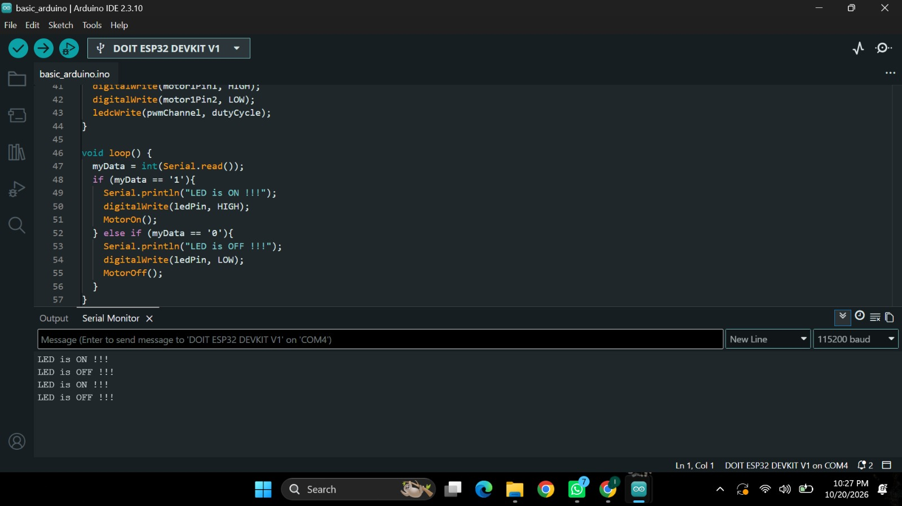
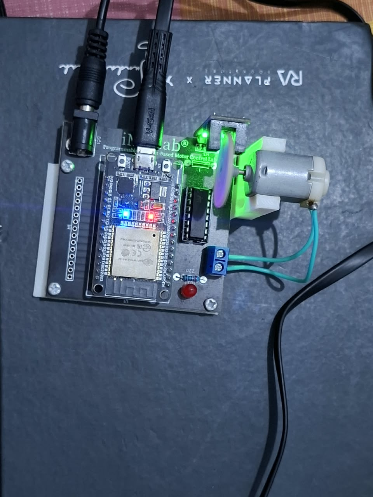

# Laporan Riset Modul 01: Basic Arduino & Control iMCLab

**Mata Kuliah:** Robotika  
**Perangkat:** ESP32 DOIT DEVKIT V1 & iMCLab Trainer Kit  
**Topik:** Komunikasi Serial, Pengendalian GPIO Digital, dan Kontrol Motor DC via PWM  

---

## 1. Ringkasan Riset & Tujuan Eksperimen

Eksperimen ini mempelajari dasar antarmuka komunikasi serial asynchronous antara komputer dan mikrokontroler ESP32 pada kit iMCLab. Sistem dirancang untuk menerima input karakter serial berupa angka `'1'` dan `'0'` pada kecepatan **115200 baud**. 

Melalui input tersebut, ESP32 memproses sinyal kontrol untuk mengendalikan dua aktuator utama:
1. **Indikator LED:** Mengubah status logika output digital (HIGH/LOW).
2. **Motor DC:** Mengatur penggerak motor menggunakan modulasi lebar pulsa (Pulse Width Modulation / PWM).

**Tujuan Eksperimen:**
* Memahami mekanisme penerimaan dan pemrosesan data serial via `Serial.read()`.
* Menguji eksekusi sinyal digital output untuk indikator LED pada ESP32.
* Mempelajari pengaturan variabel duty cycle PWM untuk menjalankan dan menghentikan motor DC.

---

## 2. Spesifikasi System & Konfigurasi Pin

| Parameter / Komponen | Deskripsi & Konfigurasi Hardware |
| :--- | :--- |
| **Mikrokontroler** | ESP32 DOIT DEVKIT V1 |
| **Baud Rate Serial** | 115200 bps |
| **Indikator LED** | GPIO 2 (Built-in LED / Indicator Kit) |
| **Pin Arah Motor** | GPIO 27 (`MotorPin1`) & GPIO 26 (`MotorPin2`) |
| **Pin Enable / PWM Motor** | GPIO 12 |
| **Frekuensi PWM** | 30.000 Hz (30 kHz) |
| **Resolusi PWM** | 8-bit (Rentang Nilai `0` – `255`) |
| **Kondisi ON (`MotorOn()`)** | Duty Cycle: `250` (~98% Kecepatan Maksimum) |
| **Kondisi OFF (`MotorOff()`)** | Duty Cycle: `0` (Motor Berhenti) |

---

## 3. Alur Kerja Sistem (System Logic)

```text
                  +--------------------------+
                  | PC / Serial Monitor      |
                  | (Baud Rate: 115200)      |
                  +------------+-------------+
                               |
                        [ Data Serial ]
                               v
                  +--------------------------+
                  | ESP32 (iMCLab Kit)       |
                  | Process: Serial.read()   |
                  +------------+-------------+
                               |
         +---------------------+---------------------+
         |                                           |
  ( Karakter '1' )                            ( Karakter '0' )
         |                                           |
  +------+-------------------+                +------+-------------------+
  | - Serial: "LED is ON !!!"|                | - Serial: "LED is OFF !!"|
  | - GPIO 2  --> HIGH       |                | - GPIO 2  --> LOW        |
  | - PWM Pin --> Duty 250   |                | - PWM Pin --> Duty 0     |
  +--------------------------+                +--------------------------+
```
  ## 4. Hasil Eksperimen & Analisis Gambar

### 4.1 Tangkapan Layar Serial Monitor

 
*Gambar 1: Tampilan jendela Serial Monitor Arduino IDE saat eksekusi perintah serial.*

**Analisis Gambar 1:**
* **Verifikasi Baud Rate:** Pada sudut kanan bawah jendela Serial Monitor, konfigurasi komunikasi serial terkonfirmasi berada pada **`115200 baud`**, yang selaras dengan inisialisasi `Serial.begin(115200)` pada kodingan.
* **Respon Balasan Serial:** Tampilan log menunjukkan rentetan pesan balik `"LED is ON !!!"` dan `"LED is OFF !!!"`. Hal ini membuktikan bahwa ESP32 berhasil membaca karakter ASCII `'1'` dan `'0'` yang dikirimkan pengguna tanpa adanya kehilangan data.
* **Eksekusi Kondisi:** Setiap kali pesan `"LED is ON !!!"` muncul, fungsi `MotorOn()` dipanggil secara bersamaan di latar belakang kodingan.

---

### 4.2 Dokumentasi Fisik Hardware iMCLab


*Gambar 2: Pengujian fisik rangkaian kit iMCLab yang terhubung dengan laptop via USB.*

**Analisis Gambar 2:**
* **Konektivitas System:** Pengujian dilakukan secara *real-time* menggunakan kit iMCLab Trainer. Terlihat modul ESP32 mendapat catu daya dan jalur komunikasi data langsung dari laptop melalui kabel USB (Port COM4).
* **Status Indikator & Aktuator:** Saat input `'1'` dikirim via Serial Monitor, LED indikator pada GPIO 2 menyala stabil. Di saat bersamaan, tegangan sebesar ~3.2V diteruskan ke *driver* motor via GPIO 12 dengan *duty cycle* 250, memicu putaran piringan motor DC pada kit.
* **Keamanan Rangkaian:** Seluruh koneksi *pinout* dari ESP32 menuju *driver* motor DC terpasang pada jalurnya tanpa mengaliri arus berlebih, menandakan konfigurasi pin GPIO 27, 26, dan 12 aman digunakan.

---

### 4.3 Matriks Hasil Pengujian Sistem

| Input Serial | Respon Serial Monitor | Status GPIO 2 (LED) | Nilai PWM (GPIO 12) | Kondisi Fisik Motor DC |
| :---: | :--- | :---: | :---: | :---: |
| `'1'` | `"LED is ON !!!"` | HIGH (3.3V) | 250 (~98%) | Berputar (*Clockwise*) |
| `'0'` | `"LED is OFF !!!"` | LOW (0V) | 0 (0%) | Berhenti (*Stop*) |

---

## 5. Pembahasan Teknis

1. **Pemrosesan Komunikasi Serial:**  
   Fungsi `Serial.read()` mengambil 1 byte data dari penyangga serial. Program mengonversi data tersebut ke nilai integer `myData`. Logika program membandingkan `myData == '1'` (ASCII 49) dan `myData == '0'` (ASCII 48).

2. **Modulasi Lebar Pulsa (PWM) ESP32:**  
   Pengaturan kecepatan motor tidak menggunakan sinyal digital murni (`HIGH`/`LOW`), melainkan modulasi frekuensi tinggi (30 kHz). Penggunaan *duty cycle* sebesar 250 dari skala 255 menghasilkan konversi tegangan rata-rata yang cukup kuat untuk mengatasi gesekan awal rotor motor DC.

3. **Arah Putaran Motor:**  
   Kombinasi logika digital `MotorPin1 (GPIO 27) = HIGH` dan `MotorPin2 (GPIO 26) = LOW` menentukan bahwa arus listrik mengalir satu arah, sehingga motor berputar searah jarum jam (*clockwise*).

---

## 6. Kesimpulan

Riset dan pengujian pada **Modul 01: Basic Arduino iMCLab** dinyatakan berhasil dengan kesimpulan sebagai berikut:
* Komunikasi serial *two-way* antara PC dan ESP32 berjalan stabil pada kecepatan `115200 baud`.
* Pengendalian LED indikator dan Motor DC dapat berjalan secara sinkron melalui pemanggilan fungsi `MotorOn()` dan `MotorOff()`.
* Penggunaan fitur PWM pada ESP32 terbukti efektif dalam mengatur pemicuan *driver* motor DC.

---
*Laporan ini disusun sebagai syarat pemenuhan nilai UTS Mata Kuliah Robotika.*
