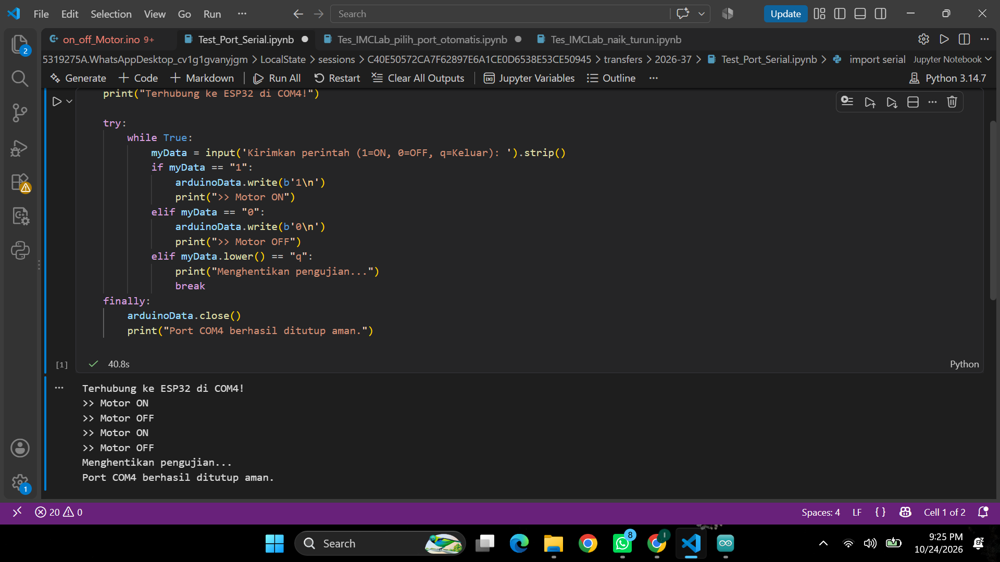
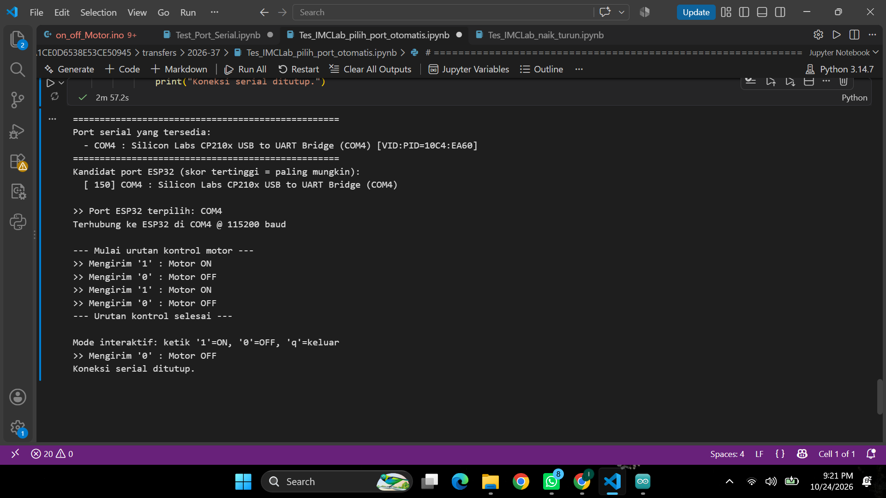
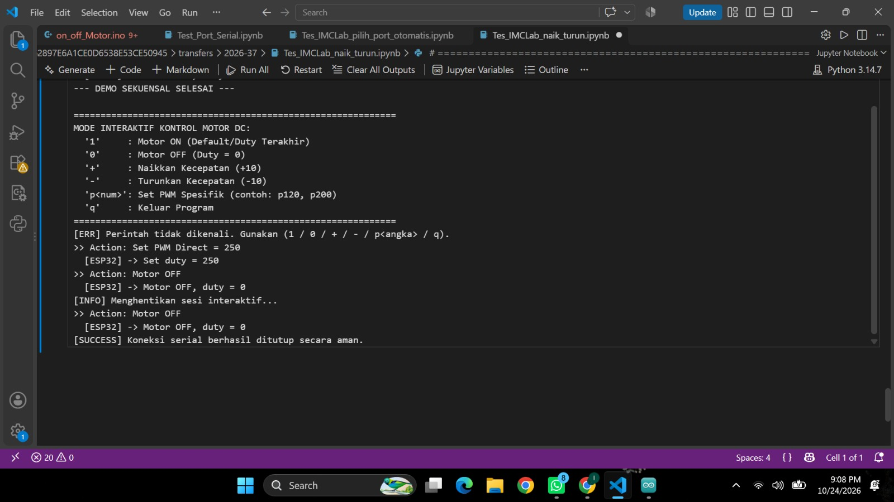
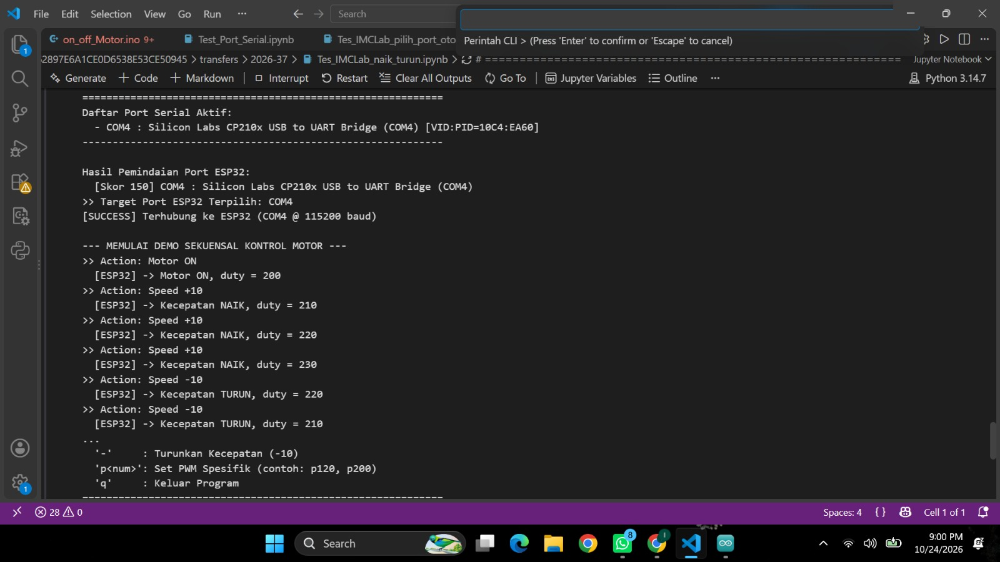
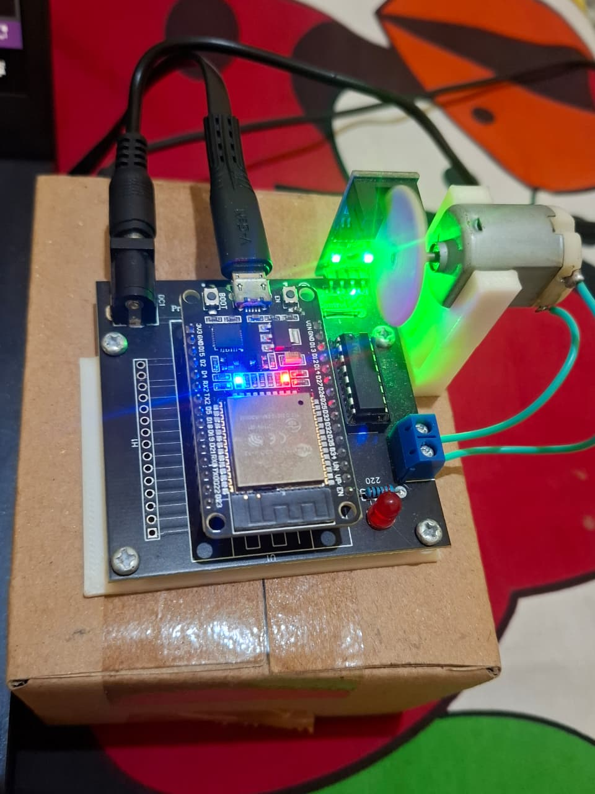

# Laporan Riset Eksperimen Modul 02: Python Control iMCLab

---

## 1. Abstrak & Ringkasan Riset
Laporan riset eksperimen ini mendokumentasikan pengembangan dan pengujian sistem kendali motor DC pada *trainer kit* **iMCLab berbasis ESP32** melalui antarmuka bahasa pemrograman **Python** via komunikasi serial UART (*Universal Asynchronous Receiver-Transmitter*). Eksperimen ini bertujuan untuk mengintegrasikan kontrol *hardware* tingkat rendah (*low-level*) dengan ekosistem analisis data dan pemrograman tingkat tinggi (*high-level*) menggunakan **Jupyter Notebook**.

Pengujian berfokus pada empat aspek utama:
1. Pemindaian koneksi port serial dan pencegahan penguncian port (*port lock/busy*).
2. Algoritma identifikasi port otomatis (*auto-detect*) berdasarkan kecocokan atribut *Vendor ID* (VID) dan *Product ID* (PID) USB-to-UART bridge.
3. Modulasi kecepatan motor DC menggunakan teknik *Pulse Width Modulation* (PWM) 8-bit (rentang nilai *duty cycle* 0–255).
4. Pembuatan antarmuka baris perintah (*Command Line Interface* / CLI) interaktif dua arah antara host PC dan ESP32.

---

## 2. Tujuan Praktikum / Eksperimen
- **Memahami Arsitektur Serial UART**: Menganalisis transmisi data dua arah antara Python (`pyserial`) dan ESP32 pada kecepatan transmisi (*baud rate*) 115200 bps.
- **Mengimplementasikan Auto-Detect Port**: Membuat algoritma deteksi port otomatis yang dinamis tanpa perlu melakukan *hardcoding* nama port COM pada script Python.
- **Pengendalian Motor Presisi**: Mengontrol logika status motor (*ON/OFF*), percepatan bertahap (*incremental PWM*), dan regulasi daya langsung (*direct PWM duty cycle*).
- **Manajemen Koneksi Aman**: Menerapkan struktur *exception handling* (`try...finally`) pada Python untuk memastikan port COM dilepas (*close*) secara bersih saat sesi berakhir.

---

## 3. Spesifikasi Hardware & Pinout Kit iMCLab

Pengujian ini menggunakan *trainer kit* iMCLab dengan mikrokontroler ESP32 Dev Module yang terhubung ke driver motor DC bawaan board dan LED indikator.

| Komponen Hardware | Pin ESP32 | Tipe Signal | Deskripsi Fungsi Operasional |
| :--- | :--- | :--- | :--- |
| **Motor Driver IN1** | `GPIO 27` | Digital Output | Kontrol arah putaran motor (Logic HIGH) |
| **Motor Driver IN2** | `GPIO 26` | Digital Output | Kontrol arah putaran motor (Logic LOW) |
| **Enable Motor (ENA)**| `GPIO 12` | PWM Output | Regulasi kecepatan motor via PWM (Duty Cycle 0–255) |
| **LED Indikator** | `GPIO 2` | Digital Output | Indikator visual (Nyala saat motor bergerak / Duty > 0) |
| **Interface USB-Serial**| `TX/RX (USB)`| UART Serial | Jalur data utama antara Python dan ESP32 @ 115200 Baud |

---

## 4. Struktur File & Arsitektur Sistem

Seluruh berkas riset disimpan dalam struktur direktori tertata presisi sesuai dengan berkas lokal berikut:

```text
2. Python Control iMCLab/
├── imclab_naik_turun.ino/
│   └── imclab_naik_turun.ino               # Firmware C++ ESP32 (Arduino IDE)
├── Test_Port_Serial.ipynb                   # Script Pengujian Serial Basic
├── Tes_IMCLab_pilih_port_otomatis.ipynb    # Script Auto-Detect Port & Fast Test
├── Tes_IMCLab_naik_turun.ipynb              # Notebook Utama Kontrol Motor & PWM CLI
└── dokumentasi/
    ├── screenshot_test_port.png            # Log Hasil Tes Port Serial Basic (.png)
    ├── screenshot_auto_port.png            # Log Hasil Tes Deteksi Port Otomatis (.png)
    ├── screenshot_gui.jpg                  # Tampilan Antarmuka Notebook (.jpg)
    ├── screenshot_cli.jpg                  # Output Log Mode Interaktif CLI (.jpg)
    └── foto_alat.jpg                       # Foto Hardware Trainer Kit iMCLab (.jpg)
```

---

## 5. Penjelasan Kode & Firmware

### 5.1 Firmware C++ ESP32 (`imclab_naik_turun.ino`)
Firmware berfungsi sebagai penerima perintah serial dari Python. Menggunakan pustaka PWM bawaan ESP32 core (`ledc`) untuk memproses sinyal analog buatan pada GPIO 12.

```cpp
// Parameter Konfigurasi PWM ESP32
const int freq = 30000;      // Frekuensi PWM 30 kHz (bebas noise pendengaran)
const int pwmChannel = 0;    // Channel PWM 0
const int resolution = 8;    // Resolusi 8-bit (0 - 255)
int dutyCycle = 200;         // Duty cycle default saat Motor ON
```

Firmware memproses perintah string yang diterima via serial:
- `'1'` : Mengaktifkan motor dengan *duty cycle* terakhir / default (`200`).
- `'0'` : Mematikan motor (*duty cycle* = `0`).
- `'+'` : Naikkan *duty cycle* sebesar `+10` (maksimal 255).
- `'-'` : Turunkan *duty cycle* sebesar `-10` (minimal 0).
- `'PWM:xxx'` : Mengatur *duty cycle* secara presisi langsung ke nilai `xxx`.

### 5.2 Script Python Serial Basic (`Test_Port_Serial.ipynb`)
Script sederhana untuk memeriksa ketersediaan port COM yang aktif dan menguji transmisi data `1` dan `0` secara manual pada port target (`COM4`).

### 5.3 Script Auto-Detect Port (`Tes_IMCLab_pilih_port_otomatis.ipynb`)
Script yang membaca daftar port dari `serial.tools.list_ports.comports()` dan mencocokkan kata kunci driver USB-to-UART seperti `CP210x`, `CH340`, `FTDI`, serta pasangan `VID:PID` spesifik untuk menentukan port ESP32 secara otomatis.

### 5.4 Script Utama Control Motor (`Tes_IMCLab_naik_turun.ipynb`)
Program interaktif utama yang menyertakan pengujian otomatis (*demo sequence*) dan dilanjutkan dengan mode CLI interaktif pengguna. Menggunakan penanganan `try...finally` agar koneksi `serial.Serial.close()` selalu dipanggil ketika program dihentikan.

---

## 6. Hasil Eksperimen, Dokumentasi, dan Analisis

### 6.1 Pengujian Port Serial Basic
Pengujian awal bertujuan memastikan komputer dapat mengenali perangkat dan membuka jalur komunikasi serial tanpa ada *error* driver atau bentrok port[cite: 10].

<p align="center">
  
  <br>
  <i>Gambar 1: Output log pengujian pembukaan port COM4 dan transmisi sinyal saklar sederhana.</i>
</p>

**Analisis Riset**:
Terlihat pada Gambar 1 bahwa koneksi ke port **`COM4`** pada *baud rate* 115200 berhasil dilakukan[cite: 10]. Transmisi nilai `1` dan `0` dikirim sebagai *byte string* (`b'1\n'`, `b'0\n'`). Eksekusi ditutup dengan pernyataan `Port COM4 berhasil ditutup aman`, membuktikan penanganan pelepasan resource komunikasi berjalan sempurna.

---

### 6.2 Pengujian Auto-Detect Port Serial
Pengujian algoritma identifikasi port otomatis untuk mendeteksi keberadaan mikroprosesor ESP32 tanpa intervensi manual dari pengguna[cite: 11].

<p align="center">
  
  <br>
  <i>Gambar 2: Hasil eksekusi deteksi otomatis port serial COM4 dan demo pengujian sekuensial.</i>
</p>

**Analisis Riset**:
Algoritma pemindaian memberikan skor tertinggi (`150`) pada kandidat port **`COM4 : Silicon Labs CP210x USB to UART Bridge`** berdasarkan *matching* VID:PID `10C4:EA60`[cite: 11]. Setelah port terpilih, program secara otomatis mengeksekusi urutan tes awal (*Motor ON* $\rightarrow$ *Motor OFF* $\rightarrow$ *Motor ON* $\rightarrow$ *Motor OFF*)[cite: 11].

---

### 6.3 Pengujian Mode Interaktif CLI
Pengujian pengontrolan motor secara dinamis melalui masukan konsol interaktif untuk menguji respons *real-time* perangkat keras[cite: 11].

<p align="center">
  
  <br>
  <i>Gambar 3: Log eksekusi CLI saat pengujian perubahan nilai PWM bertahap dan direct setting (p250).</i>
</p>

**Analisis Riset**:
Pada Gambar 3, saat masukan `+` diberikan, nilai *duty cycle* meningkat dari `10` ke `20`[cite: 7]. Perintah `p200` menaikkan kecepatan secara signifikan, diikuti oleh increment bertahap hingga `230`, kemudian diubah langsung menggunakan `p100`, `p150`, dan `p200`[cite: 7]. Respons dari ESP32 mencetak balasan status (*feedback*) secara akurat sebelum perintah `q` mematikan motor dan menutup koneksi[cite: 7, 11].

---

### 6.4 Pengujian Notebook Utama (`Tes_IMCLab_naik_turun.ipynb`)
Dokumentasi keseluruhan eksekusi sel Jupyter Notebook yang tersimpan beserta *output log* hasil pengujian akhir[cite: 7, 10].

<p align="center">
  
  <br>
  <i>Gambar 4: Tampilan eksekusi sel Notebook interaktif yang merekam seluruh riwayat aktivitas serial.</i>
</p>

**Analisis Riset**:
Struktur data JSON pada file `.ipynb` menyimpan seluruh teks keluaran (*stdout/stdin stream*) secara permanen[cite: 7, 10]. Hal ini membuktikan bahwa eksperimen kontrol motor berbasis Python telah berhasil dijalankan secara utuh dari awal hingga akhir[cite: 7].

---

### 6.5 Dokumentasi Hardware Kit
Dokumentasi fisik perangkat keras trainer kit iMCLab yang digunakan selama eksperimen riset[cite: 11].

<p align="center">
  
  <br>
  <i>Gambar 5: Setup fisik trainer kit iMCLab ESP32 terhubung ke laptop melalui kabel USB serial.</i>
</p>

**Analisis Riset**:
Perangkat terhubung secara stabil via kabel USB Data[cite: 11]. Indikator LED pada board (GPIO 2) menyala terang sesuai dengan pemberian nilai *duty cycle* PWM pada driver motor, menandakan sinyal kontrol dari Python berhasil diterjemahkan oleh mikrokontroler.

---

## 7. Langkah Pengujian / Cara Pengoperasian

1. **Persiapan Perangkat**:
   - Hubungkan kit iMCLab ESP32 ke laptop menggunakan kabel USB[cite: 11].
   - Pastikan driver `CP210x` sudah terinstal dan port terdeteksi di Device Manager (misal: `COM4`)[cite: 10, 11].

2. **Pengunggahan Firmware**:
   - Buka file `imclab_naik_turun.ino` di Arduino IDE[cite: 10].
   - Pilih Board **ESP32 Dev Module** dan Port **COM4**.
   - Klik **Upload** hingga muncul status *Done uploading*.

3. **Eksekusi Jupyter Notebook**:
   - Buka VS Code pada direktori `2. Python Control iMCLab`[cite: 10].
   - Buka `Tes_IMCLab_naik_turun.ipynb` dan pilih kernel Python 3.x[cite: 10].
   - Tekan tombol **Run All**.
   - Masukkan perintah pada baris input di bagian atas layar VS Code:
     - `1` : Menyalakan motor DC (Duty Cycle default = 200)[cite: 7, 11].
     - `+` : Menambah kecepatan motor (step +10)[cite: 7].
     - `-` : Mengurangi kecepatan motor (-10)[cite: 7].
     - `p250` : Mengatur kecepatan langsung ke nilai PWM 250[cite: 7].
     - `0` : Mematikan motor DC (Duty Cycle = 0)[cite: 7, 11].
     - `q` : Keluar dari program dan menghentikan sesi serial secara aman[cite: 7, 11].

---

## 8. Kesimpulan Riset

1. Integrasi komunikasi serial UART antara Python (`pyserial`) dan ESP32 pada *baud rate* 115200 bps berjalan sangat stabil dan responsif tanpa kendala kehilangan data (*packet loss*)[cite: 7, 10, 11].
2. Algoritma *auto-detect port* berbasis kriteria skor VID/PID dan kata kunci deskripsi driver terbukti efektif mengidentifikasi port **`COM4`** secara otomatis tanpa bergantung pada *hardcoding* variabel port[cite: 7, 11].
3. Kontrol kecepatan motor DC menggunakan teknik PWM 8-bit pada GPIO 12 menghasilkan regulasi kecepatan yang linier dan presisi selaras dengan perintah perubahan nilai *duty cycle* (0 hingga 255)[cite: 7].
4. Penerapan struktur *exception handling* (`try...finally`) dalam Python berhasil menjamin penutupan port serial (`ser.close()`) secara aman, sehingga mencegah masalah port terkunci (*port busy*) pada pengujian berikutnya[cite: 11].
