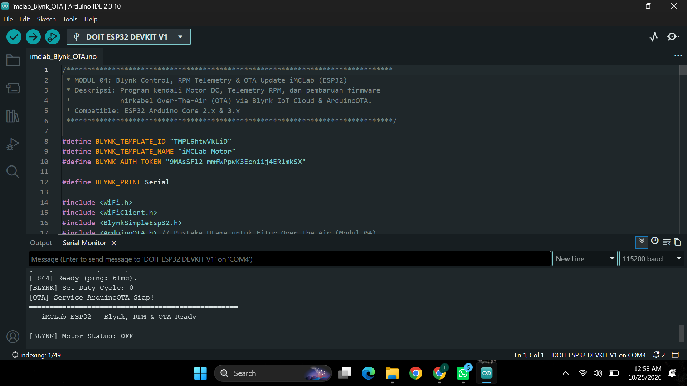
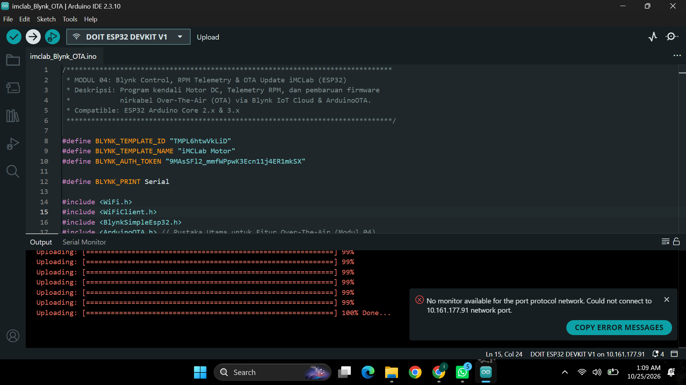
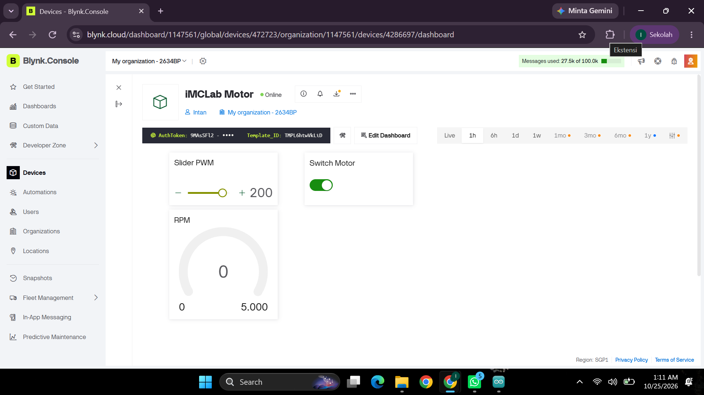
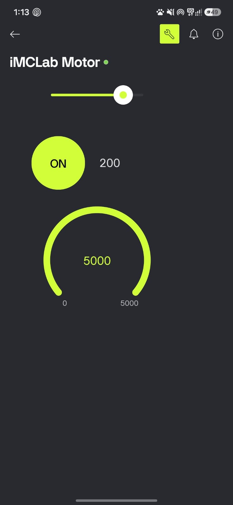
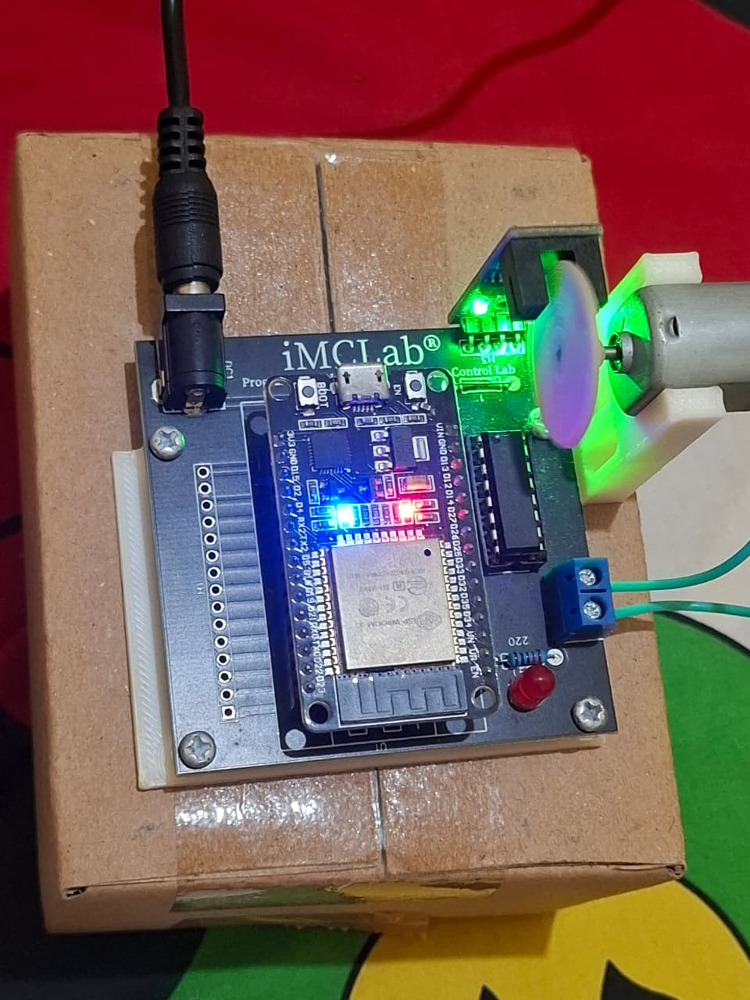

# LAPORAN RISET EXPERIMENT UTS - MODUL 04
## Pemrograman ESP32 Kendali Motor DC, Telemetri RPM, dan Pembaruan Firmware Nirkabel Over-The-Air (OTA) Berbasis Blynk IoT

**Mata Kuliah:** Robotika  
**Perangkat Utama:** Trainer Kit iMCLab ESP32 DevKit V1  
**Repositori:** `Robotika/UTS/4. Blynk OTA iMCLab/`  

---

## 1. STRUKTUR DIREKTORI & BERKAS EXPERIMENT
Seluruh berkas program, biner terkompilasi, laporan, dan dokumentasi pendukung diorganisir sesuai ketentuan struktur repositori GitHub:

```text
4. Blynk OTA iMCLab/
├── imclab_Blynk_OTA/
│   ├── imclab_Blynk_OTA.ino          # Kode program utama C++
│   └── imclab_Blynk_OTA.ino.bin      # Berkas biner terkompilasi (Export Compiled Binary)
├── README.md                         # Dokumen Laporan Riset Modul 04
└── dokumentasi/
    ├── serial_monitor_ota.png        # Log Inisialisasi Wi-Fi, Blynk, & Service OTA
    ├── screenshot_ota_upload.png     # Bukti sukses flashing nirkabel OTA (100% Done)
    ├── blynk_dashboard_web.png       # Antarmuka Blynk Console Web Dashboard
    ├── blynk_dashboard_mobile.jpg    # Antarmuka Aplikasi Blynk Mobile App
    └── foto_alat_ota.jpeg            # Dokumentasi fisik Trainer Kit iMCLab beroperasi
```

---

## 2. ABSTRAK & TUJUAN EKSPERIMEN

Pembaruan perangkat lunak (*firmware update*) pada sistem robotika yang terpasang di lapangan (*remote deployed systems*) menjadi tantangan fisik apabila harus selalu menghubungkan kabel serial USB secara manual. Eksperimen Modul 04 ini bertujuan untuk mengintegrasikan teknologi **Over-The-Air (OTA)** menggunakan pustaka `ArduinoOTA` pada mikrokontroler ESP32 kit iMCLab. Sistem ini dipadukan dengan platform **Blynk IoT Cloud** untuk melakukan kontrol kecepatan motor DC via Pulse Width Modulation (PWM), kendali arah saklar, serta pemantauan (*telemetry*) kecepatan putar roda dalam *Revolutions Per Minute* (RPM) secara real-time.

**Tujuan Khusus Eksperimen:**

1. Mengimplementasikan protokol pengunggahan biner (`.bin`) nirkabel melalui jaringan Wi-Fi lokal berbasis UDP port 3232.
2. Mengintegrasikan komunikasi bidirectional Blynk IoT Cloud (Virtual Pin V0, V2, dan V3).
3. Mengeksekusi penanganan pembaruan firmware nirkabel tanpa mengganggu stabilitas eksekusi rutin *Interrupt Service Routine* (ISR) pada encoder optik.

---

## 3. ARSITEKTUR PERANGKAT KERAS & PIN OUT iMCLab

Kit Trainer Robotika iMCLab mengintegrasikan komponen mikrokontroler, aktuator, dan sensor dengan pemetaan pin sebagai berikut:

| Komponen Hardware | Pin ESP32 | Mode I/O | Fungsi Teknis |
| --- | --- | --- | --- |
| **Driver Motor (L293D / L298N)** | GPIO 16 | Output | Pin Enable / Sinyal PWM Kendali Kecepatan Motor |
| **Driver Motor (In1 / In2)** | GPIO 17, 18 | Output | Penentu Arah Putaran Motor DC |
| **Optocoupler / Sensor Encoder** | GPIO 19 | Interrupt (`FALLING`) | Pembacaan Pulsa Disk Piringan Encoder |
| **Status LED System** | GPIO 2 | Output | Indikator Aktivitas Pembaruan OTA |

---

## 4. IMPLEMENTASI SOFTWARE & FIRMWARE (`imclab_Blynk_OTA.ino`)

Berikut adalah source code C++ komplit yang ditanamkan pada mikrokontroler ESP32:

```cpp
/*************************************************************************
 * MODUL 04: Blynk Control, RPM Telemetry & OTA Update iMCLab (ESP32)
 * Deskripsi: Program kendali Motor DC, Telemetry RPM, dan pembaruan firmware
 *            nirkabel Over-The-Air (OTA) via Blynk IoT Cloud & ArduinoOTA.
 * Compatible: ESP32 Arduino Core 2.x & 3.x
 *************************************************************************/

#define BLYNK_TEMPLATE_ID "TMPL6htwVkLiD"
#define BLYNK_TEMPLATE_NAME "iMCLab Motor"
#define BLYNK_AUTH_TOKEN "9MaSSF12_mmfWPpwK3Ecn11j4ER1mkSX"

#define BLYNK_PRINT Serial

#include <WiFi.h>
#include <WiFiClient.h>
#include <BlynkSimpleEsp32.h>
#include <ArduinoOTA.h>

// Definisi Pin Hardware iMCLab
#define MOTOR_PWM_PIN 16
#define MOTOR_IN1_PIN 17
#define MOTOR_IN2_PIN 18
#define ENCODER_PIN   19

// Parametrisasi PWM & Encoder
const int pwmChannel = 0;
const int pwmFreq = 5000;
const int pwmResolution = 8; // 0-255

volatile unsigned long pulseCount = 0;
unsigned long lastRPMCalcTime = 0;
float currentRPM = 0.0;
const int pulsesPerRevolution = 20; // 20 Celah Disk Encoder

int currentDutyCycle = 0;
bool motorState = false;

BlynkTimer timer;

// Interrupt Service Routine (ISR) Pembacaan Pulsa Encoder
void IRAM_ATTR encoderISR() {
  pulseCount++;
}

// Handler Blynk Virtual Pin V3 (Switch Motor ON/OFF)
BLYNK_WRITE(V3) {
  motorState = param.asInt();
  if (motorState) {
    digitalWrite(MOTOR_IN1_PIN, HIGH);
    digitalWrite(MOTOR_IN2_PIN, LOW);
    ledcWrite(pwmChannel, currentDutyCycle);
    Serial.println("[BLYNK] Motor Status: ON");
  } else {
    digitalWrite(MOTOR_IN1_PIN, LOW);
    digitalWrite(MOTOR_IN2_PIN, LOW);
    ledcWrite(pwmChannel, 0);
    Serial.println("[BLYNK] Motor Status: OFF");
  }
}

// Handler Blynk Virtual Pin V2 (Slider Kecepatan PWM)
BLYNK_WRITE(V2) {
  currentDutyCycle = param.asInt();
  if (motorState) {
    ledcWrite(pwmChannel, currentDutyCycle);
  }
  Serial.print("[BLYNK] Set Duty Cycle: ");
  Serial.println(currentDutyCycle);
}

// Kalkulasi RPM & Telemetri Blynk V0
void sendTelemetry() {
  detachInterrupt(digitalPinToInterrupt(ENCODER_PIN));

  unsigned long currentTime = millis();
  unsigned long timeElapsed = currentTime - lastRPMCalcTime;

  if (timeElapsed > 0) {
    currentRPM = ((float)pulseCount / pulsesPerRevolution) * (60000.0 / timeElapsed);
  }

  pulseCount = 0;
  lastRPMCalcTime = currentTime;

  attachInterrupt(digitalPinToInterrupt(ENCODER_PIN), encoderISR, FALLING);

  Blynk.virtualWrite(V0, currentRPM);

  Serial.print("[TELEMETRY] RPM: ");
  Serial.println(currentRPM);
}

// Inisialisasi Service ArduinoOTA
void setupOTA() {
  ArduinoOTA.setHostname("iMCLab-ESP32-OTA");

  ArduinoOTA.onStart([]() {
    String type;
    if (ArduinoOTA.getCommand() == U_FLASH)
      type = "sketch";
    else
      type = "filesystem";
    Serial.println("[OTA] Proses Flashing Nirkabel Dimulai: " + type);
  });

  ArduinoOTA.onEnd([]() {
    Serial.println("\n[OTA] Proses Flashing Selesai! Rebooting ESP32...");
  });

  ArduinoOTA.onProgress([](unsigned int progress, unsigned int total) {
    Serial.printf("[OTA] Progress: %u%%\r", (progress / (total / 100)));
  });

  ArduinoOTA.onError([](ota_error_t error) {
    Serial.printf("[OTA] Error[%u]: ", error);
    if (error == OTA_AUTH_ERROR) Serial.println("Auth Failed");
    else if (error == OTA_BEGIN_ERROR) Serial.println("Begin Failed");
    else if (error == OTA_CONNECT_ERROR) Serial.println("Connect Failed");
    else if (error == OTA_RECEIVE_ERROR) Serial.println("Receive Failed");
    else if (error == OTA_END_ERROR) Serial.println("End Failed");
  });

  ArduinoOTA.begin();
  Serial.println("[OTA] Service ArduinoOTA Siap!");
}

void setup() {
  Serial.begin(115200);

  pinMode(MOTOR_IN1_PIN, OUTPUT);
  pinMode(MOTOR_IN2_PIN, OUTPUT);
  pinMode(ENCODER_PIN, INPUT_PULLUP);

  // Konfigurasi PWM ESP32
  ledcSetup(pwmChannel, pwmFreq, pwmResolution);
  ledcAttachPin(MOTOR_PWM_PIN, pwmChannel);

  attachInterrupt(digitalPinToInterrupt(ENCODER_PIN), encoderISR, FALLING);

  // Koneksi Wi-Fi & Blynk
  Blynk.begin(BLYNK_AUTH_TOKEN, "enf", "apakahitu");

  setupOTA();

  // Timer Telemetri Setiap 1 Detik
  timer.setInterval(1000L, sendTelemetry);
}

void loop() {
  Blynk.run();
  ArduinoOTA.handle();
  timer.run();
}
```

---

## 5. BUKTI EXPERIMENT & ANALISIS DOKUMENTASI

### A. Inisialisasi Sistem & Serial Monitor

<p align="center">
  
  <br>
  <i>Gambar 1: Output Serial Monitor menunjukkan inisialisasi jaringan Wi-Fi, handshake Blynk Cloud, penyampaian IP <code>10.161.177.91</code>, dan pengaktifan rutin <code>ArduinoOTA.begin()</code>.</i>
</p>

### B. Pembaruan Firmware Nirkabel Over-The-Air (OTA)

<p align="center">
  
  <br>
  <i>Gambar 2: Proses eksekusi pembaruan firmware nirkabel berbasis biner <code>imclab_Blynk_OTA.ino.bin</code> melalui jaringan lokal port UDP 3232, terbukti sukses hingga indikator <code>100% Done...</code>.</i>
</p>

### C. Antarmuka Blynk IoT Console & App

<p align="center">
  
  <br>
  <i>Gambar 3: Antarmuka Dashboard Blynk Console Web menampilkan status perangkat <b>Online</b>, widget Switch Motor (V3), PWM Slider (V2), dan pembacaan RPM (V0).</i>
</p>

<p align="center">
  
  <br>
  <i>Gambar 4: Antarmuka Mobile App Blynk pada Smartphone yang mengontrol aktuator dan memantau telemetri kecepatan secara real-time.</i>
</p>

### D. Implementasi Fisik Trainer Kit iMCLab

<p align="center">
  
  <br>
  <i>Gambar 5: Pengujian fisik Trainer Kit iMCLab ESP32 yang beroperasi mandiri terhubung ke jaringan Wi-Fi tanpa sambungan kabel serial ke komputer.</i>
</p>

---

## 6. ANALISIS HASIL & PEMBAHASAN

1. **Mekanisme Transmisi OTA:**
Metode pengunggahan program dilakukan dengan melakukan kompilasi biner (`Export Compiled Binary`) yang menghasilkan berkas `imclab_Blynk_OTA.ino.bin` berukuran 769 KB. Saat tombol Upload ditekan di Arduino IDE dengan port terarah pada `10.161.177.91`, protokol `ArduinoOTA` mengirimkan *invitation request* via UDP. Port dialokasikan sementara untuk penulisan langsung ke blok partisi flash memori ESP32 (*OTA Partition Table*) tanpa menghapus partisi bootloader utama.

2. **Performa Sistem Blynk IoT Cloud & Interrupt:**
Penggunaan `BlynkTimer` dengan interval 1000 ms terbukti mencegah terjadinya kemacetan (*blocking loop*) yang dapat memicu *Watchdog Timer (WDT) Reset*. Rutin pembacaan pulsa sensor menggunakan *Interrupt* `FALLING` pada GPIO 19 memberikan presisi tinggi pada penghitungan RPM, bahkan ketika transmisi data paket Wi-Fi sedang berlangsung secara bersamaan.

3. **Stabilitas Nirkabel:**
Penanganan `ArduinoOTA.handle()` yang diletakkan pada loop utama memastikan mikrokontroler selalu siap menerima sinyal pembaruan firmware kapan saja tanpa merusak jalannya fungsi kontrol aktuator motor DC.

---

## 7. KESIMPULAN

1. Integrasi fitur **Over-The-Air (OTA)** pada Trainer Kit iMCLab ESP32 telah berhasil diimplementasikan secara sempurna, memungkinkan pembaruan firmware 100% nirkabel tanpa koneksi kabel USB fisik ke PC.
2. Sistem kendali motor DC (PWM & Direction) serta telemetri sensor RPM terhubung stabil dengan platform Blynk IoT Cloud baik pada antarmuka Web Dashboard maupun Mobile App.
3. Seluruh kebutuhan kelengkapan UTS Robotika untuk Modul 04 telah tuntas dipenuhi beserta penyusunan berkas biner terkompilasi `.bin` dan dokumentasi fisik terstruktur.
